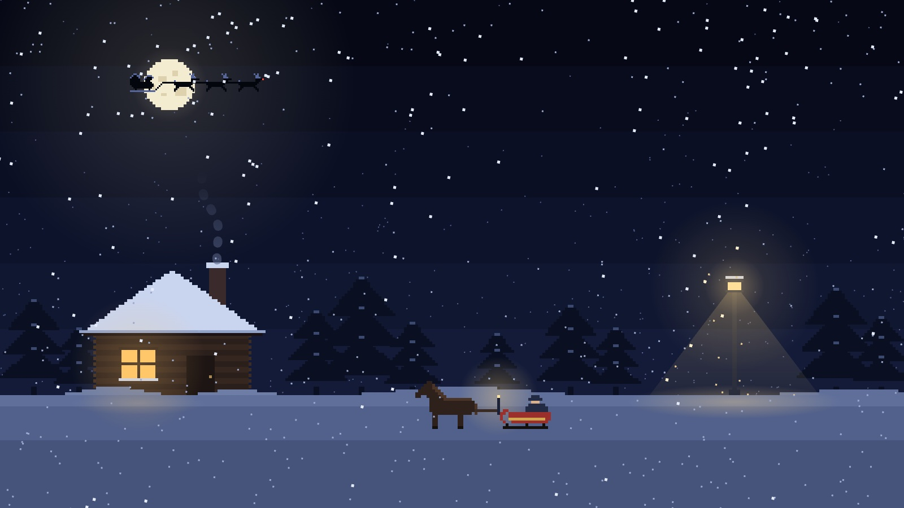
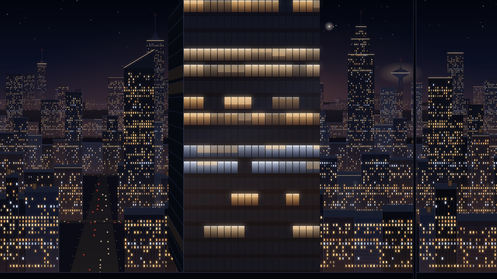

# claude-mods

Themes and mods for Claude Code and the Claude desktop app.

## Amber Night


A warm starry night behind the conversation in the desktop and mobile apps. Four layers of stars drift slowly sideways past an amber Milky Way, with an occasional comet. The scene stops moving when your system asks for reduced motion.

- `/amber-night` turns it on for the session.
- `/amber-night-off` turns it off.

It turns itself on when a session starts. To limit that to one account, set **Only for account email** to that account's email: it then turns on by itself only when that account is signed in. This helps when two desktop apps share one `~/.claude` folder and you want a theme in only one of them.

### Install

At the prompt of a terminal session:

```
/plugin install amber-night --marketplace mitya86/claude-mods
```

From a shell:

```bash
claude plugin install amber-night --marketplace mitya86/claude-mods
```

Answer `y` to add the marketplace, then pick a scope (user scope loads it in every session).

In the desktop app, where `/plugin` does not run: click + next to the prompt box, then Plugins, Add marketplace with `mitya86/claude-mods`, then Add plugin.

## Christmas Eve



An 8-bit snowy night behind the conversation in the desktop and mobile apps: a log hut with smoke from its chimney, pines, a lamp post and a full moon, in a blizzard of falling snow. Now and then Santa's sleigh crosses the moon, and a horse-drawn sleigh passes along the road. The snow runs on a 16 fps clock to stay light on the CPU, and the scene stops moving when your system asks for reduced motion.

- `/christmas-eve` turns it on for the session.
- `/christmas-eve-off` turns it off.

It has the same **Only for account email** option as Amber Night, so you can run each theme in a different desktop app.

### Install

```
/plugin install christmas-eve --marketplace mitya86/claude-mods
```

```bash
claude plugin install christmas-eve --marketplace mitya86/claude-mods
```

In the desktop app: + next to the prompt box, then Plugins, Add marketplace with `mitya86/claude-mods`, then Add plugin.

## Downtown Night



The view from a high window over a city at night, behind the conversation in the desktop and mobile apps. A glass tower stands just across the street, with warm-lit skyscrapers behind it, a needle tower with a blinking light, and stars above the haze. Traffic moves slowly along the streets far below, windows turn on and off now and then, and once in a while a plane crosses the sky. It runs on a 10 fps clock to stay light on the CPU, and stops moving when your system asks for reduced motion.

- `/downtown-night` turns it on for the session.
- `/downtown-night-off` turns it off.

It has the same **Only for account email** option as Amber Night.

### Install

```
/plugin install downtown-night --marketplace mitya86/claude-mods
```

```bash
claude plugin install downtown-night --marketplace mitya86/claude-mods
```

In the desktop app: + next to the prompt box, then Plugins, Add marketplace with `mitya86/claude-mods`, then Add plugin.
